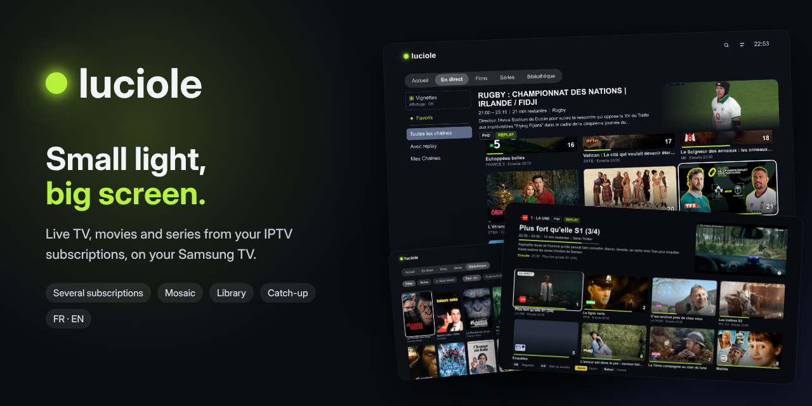
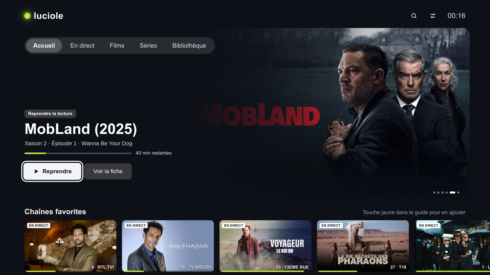
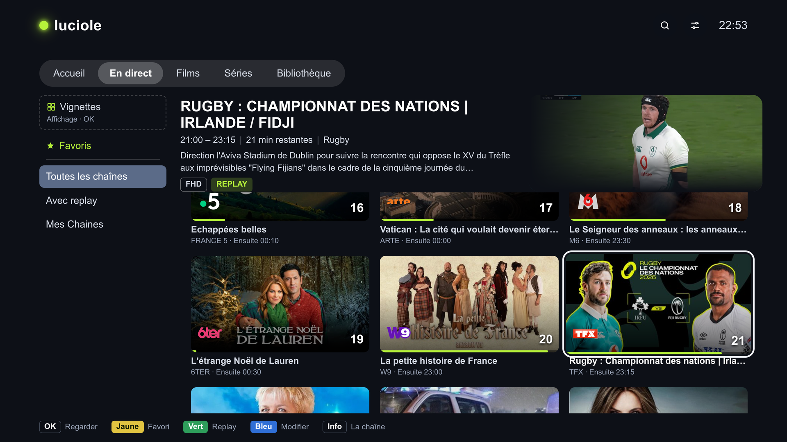
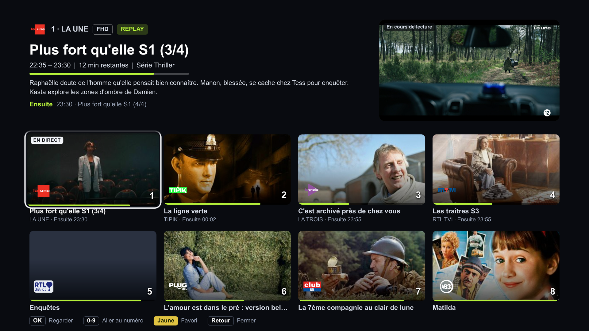
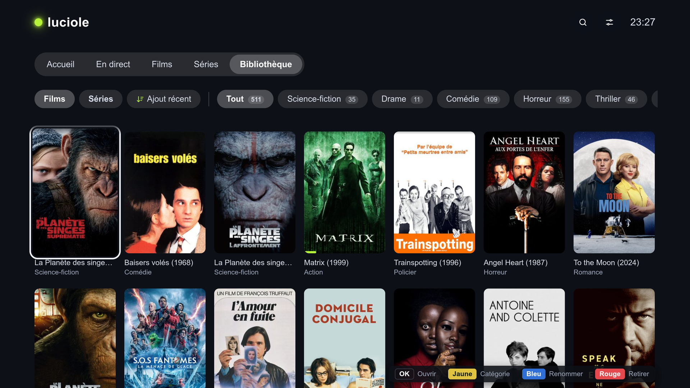
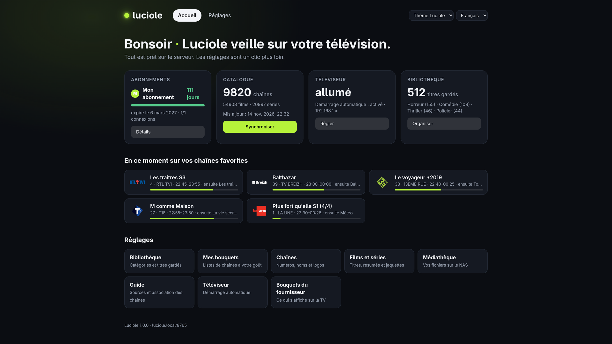

# Luciole



**Luciole** puts the live TV, movies and series of your IPTV subscriptions on a Samsung TV, with an interface built
for the remote control. A small server at home does the heavy lifting; the TV only displays and plays.

*[Version française](README.md)* — the detailed guides are in French; this page covers everything you need in English.

Luciole comes in two parts:

- **a server** written in Python, running in a Proxmox container, on a Raspberry Pi or on any Debian PC.
  It talks to Xtream providers, builds the programme guide, prepares images and can open the app when the TV turns on;
- **an app** for Samsung (Tizen) TVs, installed in developer mode.

## Features

- **Several subscriptions at once.** Live TV mixes the channels of all your subscriptions in one list.
  A coloured badge shows where each channel comes from, and a filter shows just one subscription.
- **A grid guide**, with a video preview of the channel you stop on.
- **The mosaic**: during live TV, the Right key shows every channel as a tile with what's on now and next.
  The channel you were watching keeps playing in a corner.
- **The Library**: keep the movies and series you like, filed in your own categories.
  The category is suggested from the title's genre and changes in one click.
- **Catch-up**, when the provider offers it, and "from the start" on the current programme.
- **Your media library**: movies and series from a NAS show up next to the catalogue, with details and posters.
- **Resume playback**, history, "Watch later", favourite channels.
- **Subscription status**: expiry date, days left, connections in use.
- **Automatic start**: when the TV turns on, Luciole opens instead of Samsung TV Plus. Set up from the TV itself.
- **Two themes**, Luciole (green) and Amber, and **two languages**, French and English,
  chosen separately on the TV and on the web page.
- **A web page** to organise everything from a computer: bouquets, channel names and numbers, logos, posters,
  guide, media library. It opens at `http://luciole.local:8765`.











## Installing the server

Both files to install, `luciole-server-1.0.1.tar.gz` (the server) and `Luciole.wgt` (the TV app),
are on the [Releases](https://github.com/EmmaDuch/luciole-tv/releases) page.

On a Debian 12/13 machine (Proxmox LXC container, Raspberry Pi OS 64-bit, or PC), as root:

```sh
tar xzf luciole-server-1.0.1.tar.gz && cd luciole-server
sh install.sh                       # LUCIOLE_TZ=Europe/London sh install.sh to set another time zone
nano /etc/luciole/config.toml       # your subscriptions, see below
systemctl start luciole luciole-sync.timer
```

Then open `http://luciole.local:8765`. Give the server a fixed address in your router.
On a Raspberry Pi, the first synchronisation is slow (every image is resized once), then everything is cached.

One `[[xtream]]` block per subscription in `/etc/luciole/config.toml`:

```toml
[[xtream]]
nom = "Home"            # display name
id = "home"             # never change it: favourites, history and library are tied to it
server = "http://provider-address:8080"
username = "..."
password = "..."
decalage = 0            # added to every channel number of this subscription (e.g. 1000)
```

Credentials stay in this file, readable by root only. Do not expose port 8765 on the Internet.

## Installing the TV app

1. On the TV: **Apps** panel, type **1 2 3 4 5** on the remote, set **Developer mode** to On with your computer's IP,
   then restart the TV.
2. Install `Luciole.wgt` with **Apps2Samsung**. The app identifier is `LucioleApp.Luciole`.
3. On first launch, type the server's IP address (the TV does not resolve `.local` names).

## Remote control

| Key | In the guide | During live TV |
|---|---|---|
| OK | watch | full control bar |
| Up, P+ | previous row | next channel (1, 2, 3…, wraps around at the end) |
| Down, P− | next row | previous channel |
| Left | categories | quick channel list |
| Right | — | **mosaic** |
| 0–9 | go to number | go to number |
| Yellow | favourite | favourite |
| Green | catch-up | catch-up |
| Blue | edit channel / rename bouquet | — |
| Info | channel page | channel page |

In the mosaic: arrows choose a channel, **OK** watches it, **0–9** jumps to a number, **P+ / P−** move a whole row,
**Yellow** toggles favourite, **Back** returns to live TV.

In the Library: **Yellow** changes the category, **Red** removes the title, **Blue** on a category renames it.

## Licence

GPL-3.0. See [LICENSE](LICENSE). Luciole provides no content: it plays subscriptions you already have.
