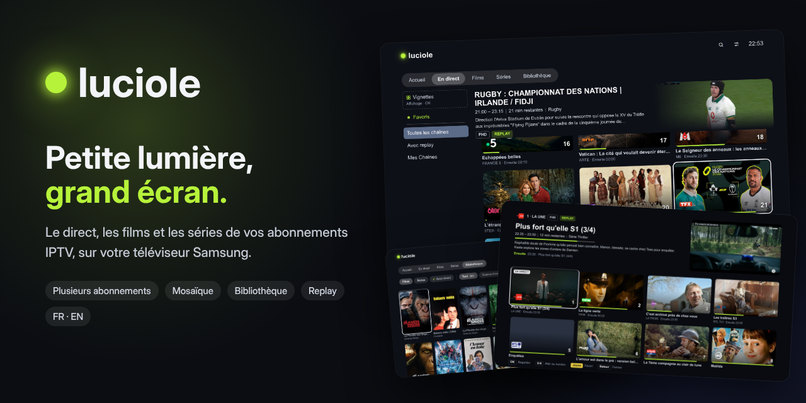
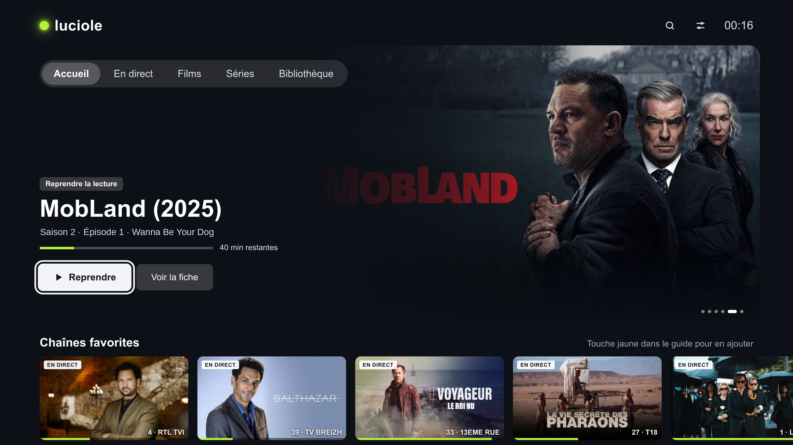
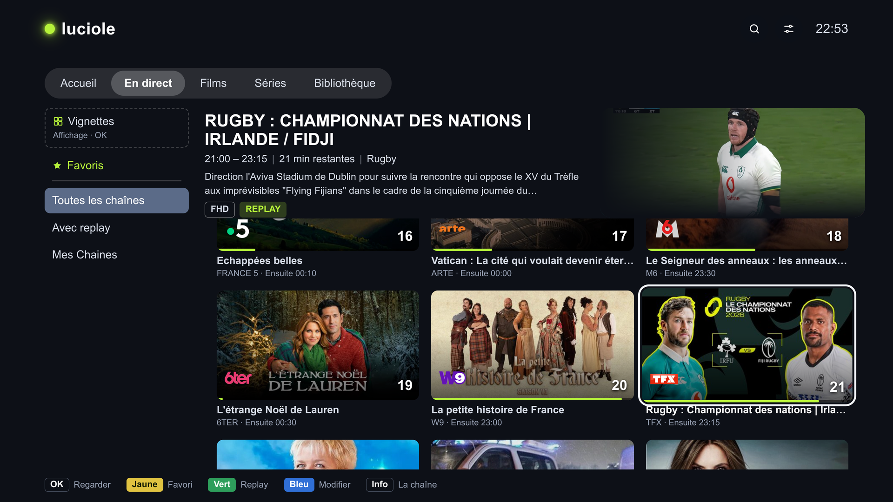
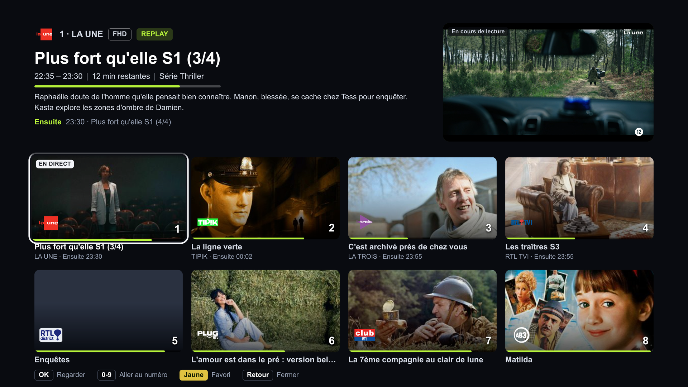
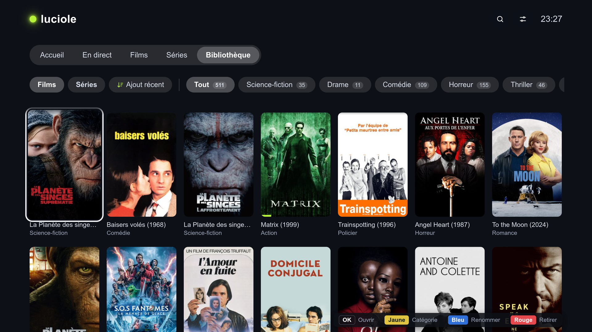
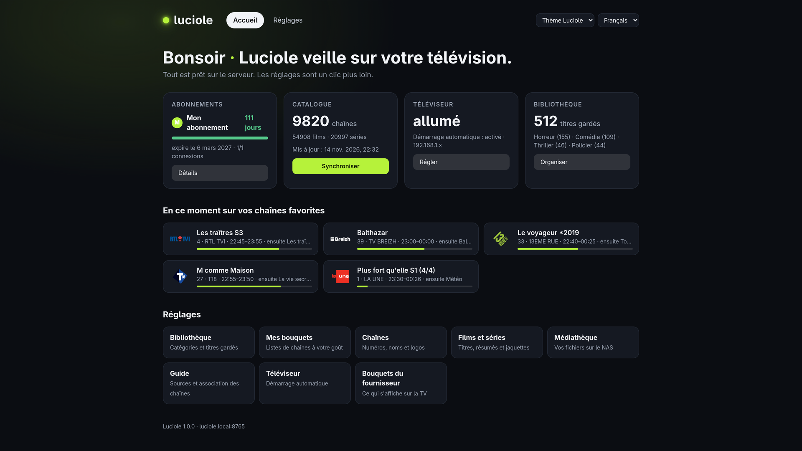

# Luciole

**Luciole** met le direct, les films et les séries de vos abonnements IPTV sur un téléviseur Samsung,
avec une interface pensée pour la télécommande. Le travail lourd se fait sur un petit serveur à la maison.
Le téléviseur, lui, ne fait qu'afficher et lire.

*[English version](README.en.md)*

Luciole est en deux morceaux :

- **un serveur** en Python, qui tourne sur un conteneur Proxmox, un Raspberry Pi ou n'importe quel PC sous Debian.
  Il parle aux fournisseurs Xtream, construit le guide des programmes, prépare les images
  et peut allumer l'appli quand le téléviseur s'allume ;
- **une appli** pour téléviseur Samsung (Tizen), installée en mode développeur.

## Ce que fait Luciole

- **Plusieurs abonnements à la fois.** Le direct mélange les chaînes de tous vos abonnements dans une seule liste.
  Une pastille de couleur dit d'où vient chaque chaîne, et un filtre n'en montre qu'un seul.
- **Un guide en grille**, avec aperçu vidéo de la chaîne sur laquelle on s'arrête.
- **La mosaïque** : en direct, la touche droite montre toutes les chaînes en vignettes,
  avec le programme en cours et le suivant. La chaîne regardée continue dans un coin.
- **La Bibliothèque** : vous gardez les films et les séries que vous aimez, rangés dans vos propres catégories.
  La catégorie se propose toute seule d'après le genre du film, et se change d'un clic.
- **Le replay**, quand le fournisseur le propose, et « depuis le début » sur le programme en cours.
- **Votre médiathèque** : les films et séries d'un NAS apparaissent à côté du catalogue, avec fiches et jaquettes.
- **Reprise de lecture**, historique, « À regarder plus tard », chaînes favorites.
- **L'état de vos abonnements** : date d'expiration, jours restants, connexions utilisées.
- **Démarrage automatique** : quand le téléviseur s'allume, c'est Luciole qui s'ouvre, pas Samsung TV Plus.
  Se règle depuis le téléviseur lui-même.
- **Deux thèmes**, Luciole (vert) et Ambre, et **deux langues**, français et anglais,
  au choix sur le téléviseur et sur la page web.
- **Une page web** pour tout organiser depuis un ordinateur : bouquets, noms et numéros des chaînes,
  logos, jaquettes, guide, médiathèque. Elle s'ouvre sur `http://luciole.local:8765`.

## Installer

Les deux fichiers à installer, `luciole-server-1.0.1.tar.gz` (le serveur) et `Luciole.wgt` (l'appli du téléviseur),
sont sur la page [Releases](https://github.com/EmmaDuch/luciole-tv/releases) du dépôt.

1. **Le serveur** : voir [server/LISEZMOI.md](server/LISEZMOI.md). Deux exemples complets :
   un conteneur Proxmox, et un Raspberry Pi ou un PC.
2. **L'appli sur le téléviseur** : voir [tv/LISEZMOI.md](tv/LISEZMOI.md).
3. **Au quotidien** : les touches de la télécommande et chaque écran sont décrits dans
   [docs/UTILISATION.md](docs/UTILISATION.md).

Ce qu'il faut :

- un abonnement IPTV au format **Xtream Codes** (adresse, identifiant, mot de passe) ;
- un téléviseur **Samsung sous Tizen**, en mode développeur ;
- une machine allumée en permanence sur le réseau de la maison, sous **Debian 12 ou 13**
  (ou Raspberry Pi OS 64 bits). Python 3.11 et Pillow, rien d'autre.

## Sécurité

- Vos identifiants d'abonnement restent dans `/etc/luciole/config.toml`, sur le serveur, lisibles par root seul.
  Ils ne sont jamais affichés par la page web, ni envoyés au téléviseur ailleurs que dans l'adresse de lecture des vidéos.
- Le serveur est fait pour le réseau de la maison. N'ouvrez pas son port sur Internet dans votre modem.
- Un mot de passe facultatif (`token` dans la configuration) protège le serveur si d'autres personnes
  utilisent votre réseau.

## Pour les curieux

- [CHANGELOG.md](CHANGELOG.md) : ce qui change dans cette version.
- [maquette/](maquette/) : deux faux fournisseurs, un faux TMDB et le script qui refait toutes les captures
  de cette documentation sans vrai abonnement.
- [images/MANIFEST.md](images/MANIFEST.md) : la liste numérotée des images, pour les remplacer par vos propres captures.

## Licence

GPL-3.0. Voir [LICENSE](LICENSE).

Luciole ne fournit aucun contenu : il lit les abonnements que vous possédez déjà.
