# Utiliser Luciole sur le téléviseur

Tout se fait à la télécommande. Les flèches déplacent la sélection, **OK** valide, **Retour** revient en arrière.
Sur l'écran d'accueil, deux appuis sur Retour ferment Luciole.

## Premier lancement

Luciole demande l'adresse du serveur sur votre réseau, par exemple `192.168.1.20`.
Le port 8765 est ajouté tout seul. Le mot de passe ne sert que si vous en avez mis un dans la configuration
du serveur (`token`). Laissez-le vide sinon.

L'adresse se change plus tard dans **Réglages › Serveur Luciole**.

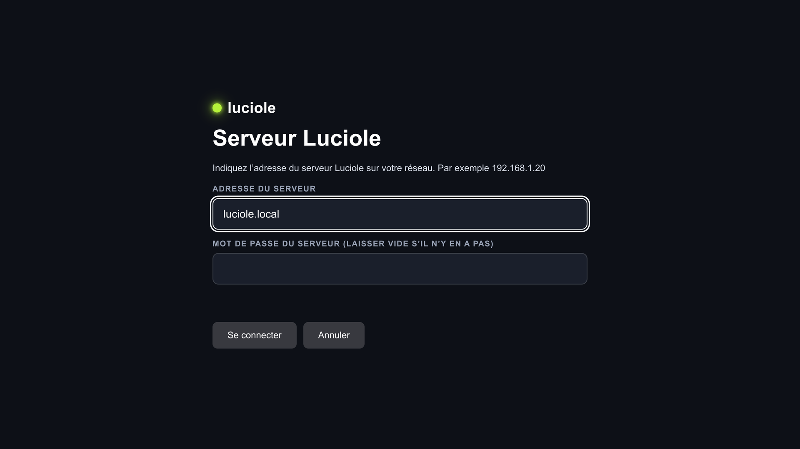

## L'accueil

En haut, les rubriques : **Accueil**, **En direct**, **Films**, **Séries**, **Bibliothèque**, puis la recherche
et les réglages. Le grand bandeau reprend ce que vous regardiez (un film commencé, l'épisode suivant d'une série),
puis les films ajoutés récemment. Gauche et droite font défiler le bandeau.

En dessous : vos chaînes favorites avec leur programme en cours, les lectures à reprendre,
les films ajoutés récemment et les séries mises à jour.

## En direct : le guide

La colonne de gauche liste vos bouquets : **Favoris**, **Toutes les chaînes**, **Avec replay**,
vos bouquets personnels, puis ceux des fournisseurs.

Les chaînes s'affichent en **vignettes** : le programme en cours avec son image quand le guide XMLTV
en fournit une (sinon la couleur et le logo de la chaîne), sa progression, et l'heure du suivant.
La première ligne de la colonne de gauche, **Affichage**, passe des vignettes à la **grille horaire**
(trois heures de programmes, pour aller dans le temps et vers le replay) et inversement ; le choix est retenu.
Arrêtez-vous sur une chaîne : elle se lance en petit, en haut à droite (réglable dans les Réglages).

| Touche | Dans le guide |
|---|---|
| OK | regarder la chaîne (dans la grille, sur un programme passé : le replay, s'il existe) |
| Jaune | ajouter ou retirer des favoris |
| Vert | replay de la chaîne |
| Bleu | changer le numéro ou le nom de la chaîne (sur un bouquet : le renommer) |
| Info | page de la chaîne |
| 0 à 9 | aller à un numéro de chaîne |

### Plusieurs abonnements

Avec plusieurs abonnements, chaque chaîne porte une **pastille** : la lettre de son abonnement
sur sa couleur. Toutes les chaînes sont mélangées dans une seule liste, rangées par numéro.

Sous « Affichage », la colonne de gauche commence par le **filtre** : « Tous les serveurs ».
OK passe à l'abonnement suivant, puis au suivant, puis revient à tous.
Les bouquets et les chaînes affichés suivent le filtre.

Lettre et couleur de chaque abonnement se choisissent sur la page web, section Abonnements.

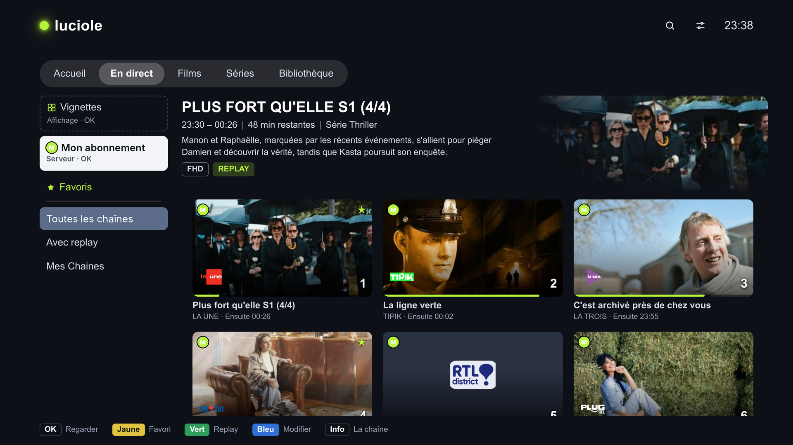

## En direct : le lecteur

Au lancement d'une chaîne, une barre discrète montre la chaîne, le programme et le temps restant.
Elle s'efface au bout de quelques secondes.

| Touche | Pendant le direct |
|---|---|
| Haut, P+ | chaîne suivante : 1, 2, 3… En fin de liste, on revient à la première |
| Bas, P− | chaîne précédente |
| 0 à 9 | aller à un numéro |
| Gauche | liste rapide des chaînes, à gauche de l'écran |
| Droite | la mosaïque |
| OK | barre complète : Accueil, Guide, Mosaïque, Depuis le début, Replay, pistes audio et sous-titres |
| Guide | guide des programmes de la chaîne |
| Jaune | favori |
| Vert | replay |
| Info | page de la chaîne |
| Retour | replier la barre, puis quitter le lecteur |

Haut et Bas parcourent toute la liste d'où vous êtes parti : la catégorie choisie dans le guide,
et seulement l'abonnement filtré s'il y en a un.

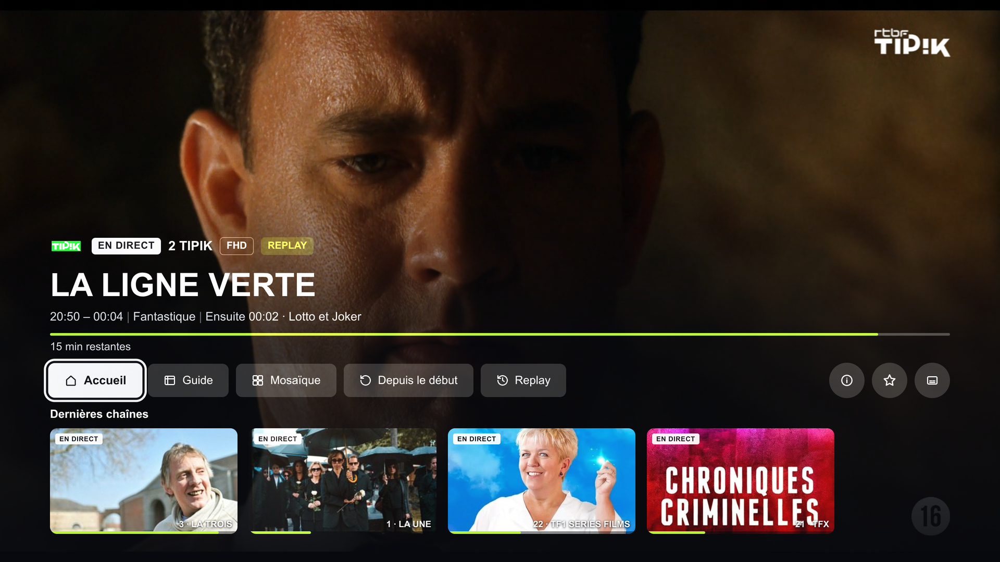

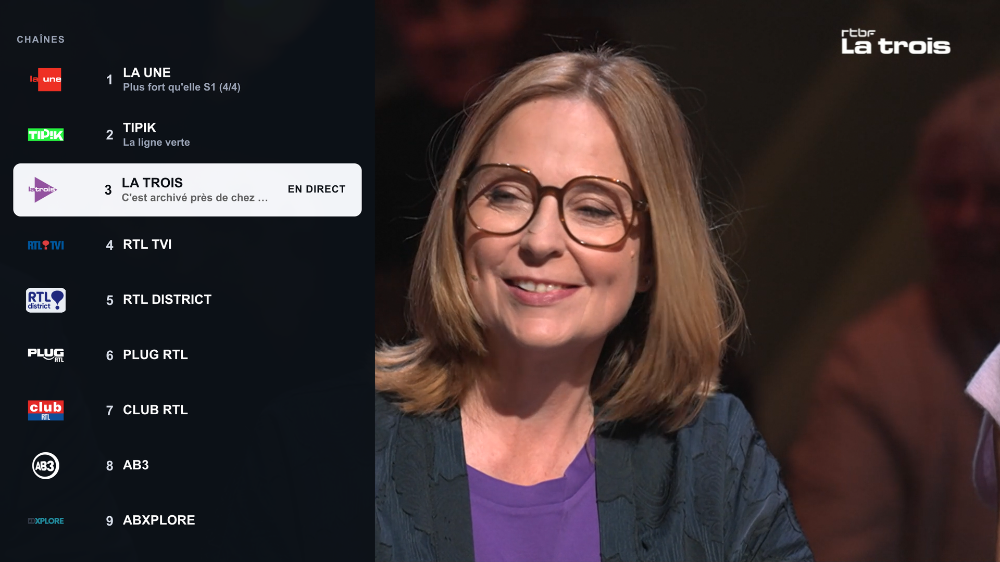

## La mosaïque

En direct, la **touche droite** ouvre la mosaïque : toutes les chaînes de la liste en vignettes,
avec le programme en cours, sa progression et l'heure du suivant. En haut, la fiche de la vignette choisie :
titre, horaire, résumé, et ce qui vient ensuite.

La chaîne que vous regardiez continue dans le cadre en haut à droite. Le téléviseur ne sait lire qu'une vidéo à la fois :
les vignettes montrent donc l'image du programme quand le guide en fournit une, pas la vidéo de chaque chaîne.

| Touche | Dans la mosaïque |
|---|---|
| Flèches | choisir une chaîne |
| OK | la regarder |
| 0 à 9 | aller directement à un numéro, puis OK |
| P+ / P− | une rangée plus bas ou plus haut |
| Jaune | favori |
| Retour | revenir au direct |

## La page d'une chaîne

Touche **Info** sur une chaîne. Le programme en cours et le suivant, avec leur image quand le guide en a une,
le bouquet et l'abonnement d'où vient la chaîne, et d'autres chaînes du même bouquet.

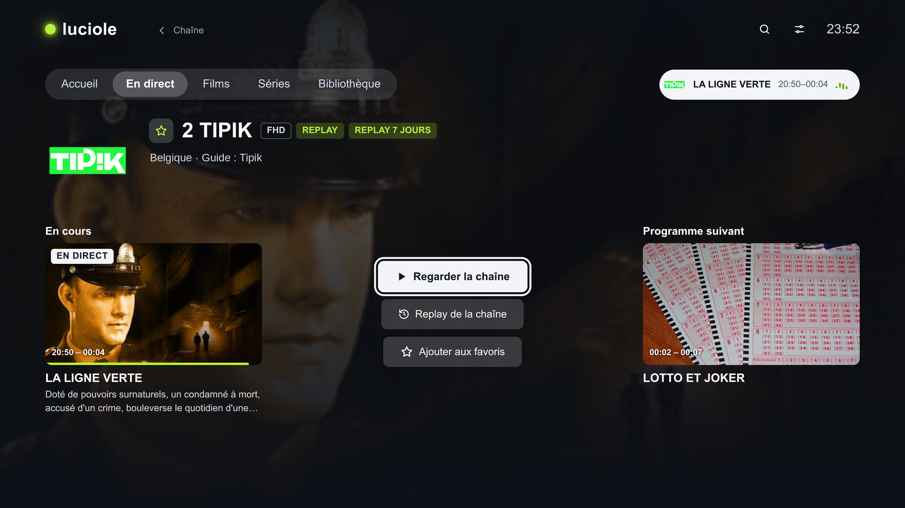

## Le replay

Pour les chaînes dont le fournisseur garde les émissions passées : les jours en haut, les programmes en dessous.
Ce qui n'a pas été enregistré par le fournisseur est grisé.

Sur un programme en cours, **Depuis le début** reprend l'émission à son début.

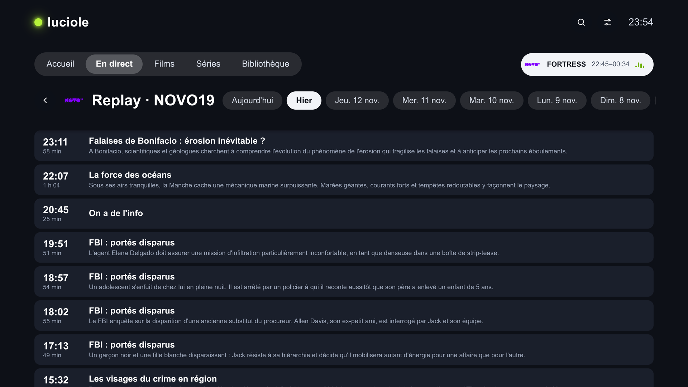

## Films et séries

Les catégories en haut, le catalogue en dessous. Les deux premières tuiles mènent à l'**Historique**
et à la liste **À regarder plus tard**. Touche **jaune** sur une affiche : la mettre de côté.

Avec plusieurs abonnements, chaque catégorie porte la pastille de son abonnement.

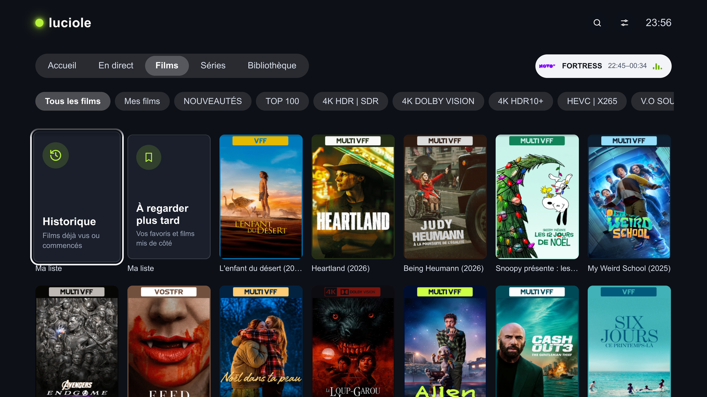

## La fiche d'un film

**Regarder** (ou **Reprendre**), **Depuis le début**, **Bande-annonce** quand il y en a une,
puis le bouton **Bibliothèque**, le signet « À regarder plus tard » et l'étoile des favoris.

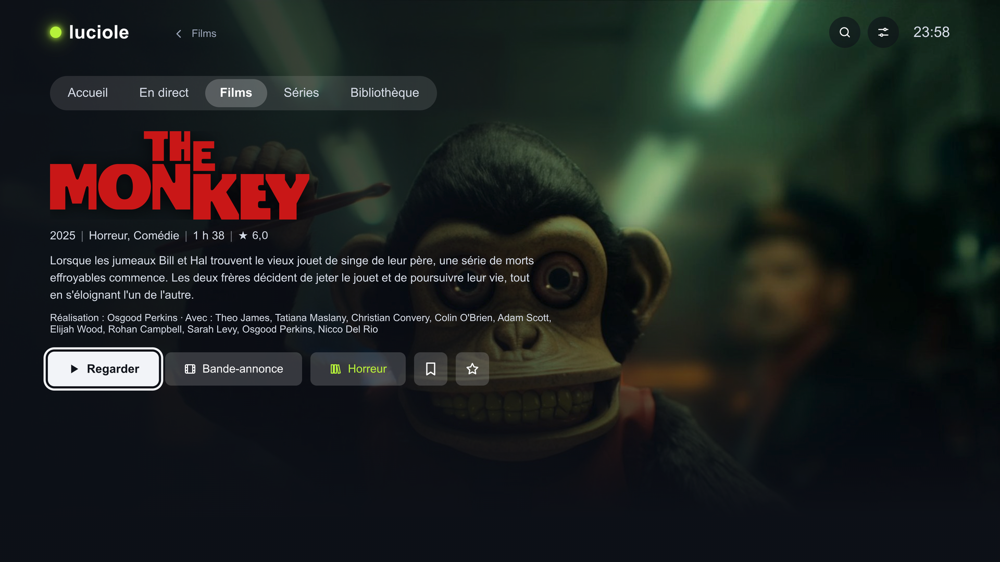

### Un film en plusieurs versions

Les films de votre médiathèque qui existent en plusieurs fichiers (4K, 1080p, 720p…) n'ont qu'**une fiche**.
Les versions sont reconnues par l'identifiant TMDB (`{tmdb-…}` dans le nom du dossier, ou trouvé par le serveur),
ou par le même titre et la même année dans le même dossier : `Dune (2021).mkv`, `Dune (2021) - 4K.mkv`.

La fiche montre un bouton de plus, la version qui démarrera (« 1080p · H.264 — 3 versions »). OK dessus pour choisir :

- **Automatique** (par défaut) : la meilleure version que le téléviseur sait lire. Un 4K au son DTS est écarté
  au profit d'un 1080p lisible ;
- ou une version précise, retenue pour ce film.

Si la version lancée ne démarre pas, Luciole passe tout seul à la suivante et le dit.
La reprise, l'historique et la Bibliothèque sont communs à toutes les versions.

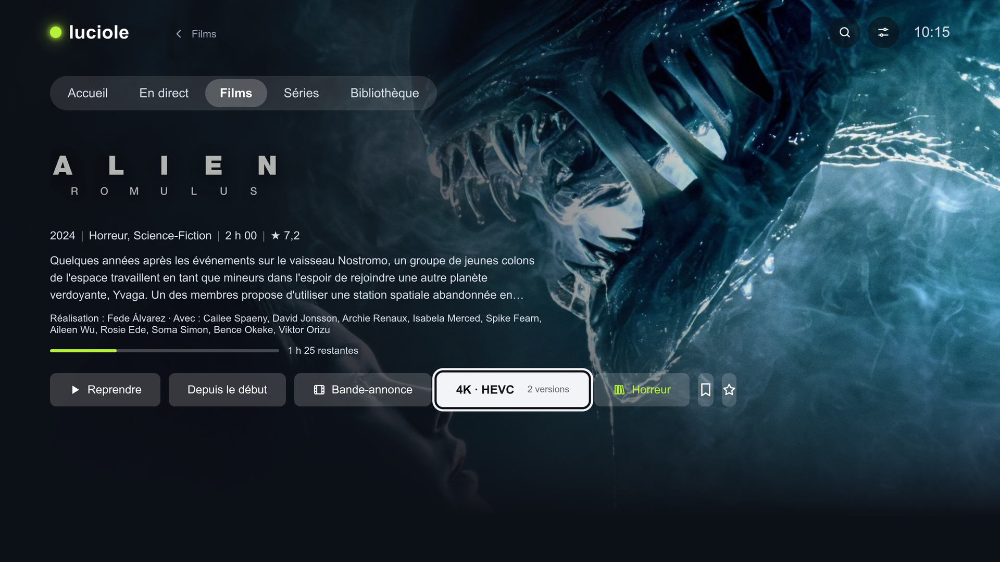

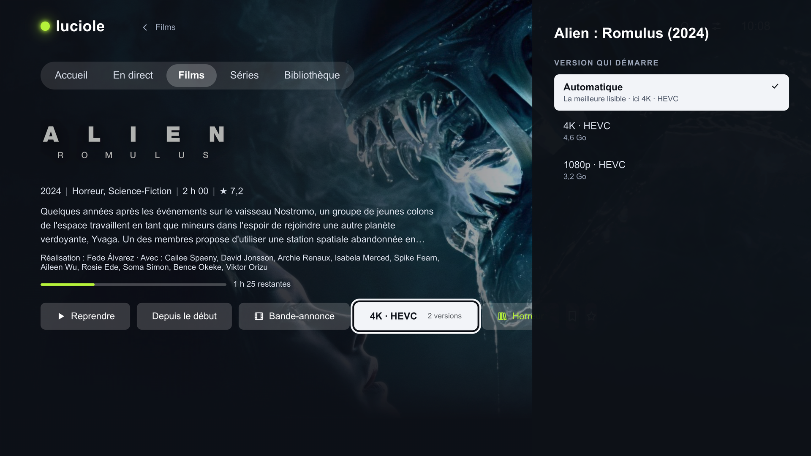

### Bonus, bande-annonce et logo

Pour les films et séries de votre médiathèque rangés à la manière de Kodi, Plex ou Jellyfin :

- **Bande-annonce** : un fichier `…-trailer.mp4` à côté du film (ou un dossier `Trailers`) est lu directement,
  avant celle de YouTube ;
- **Bonus** : les sous-dossiers `Deleted Scenes`, `Interviews`, `Featurettes`, `Behind The Scenes`, `Extras`…
  et les fichiers `…-featurette`, `…-interview`, `…-deleted` apparaissent dans un bouton **Bonus** de la fiche ;
  ils ne se mélangent plus aux films ;
- **Logo** : un `…-clearlogo.png` remplace le titre écrit en haut de la fiche ; `…-poster` et `…-fanart`
  donnent l'affiche et le fond.

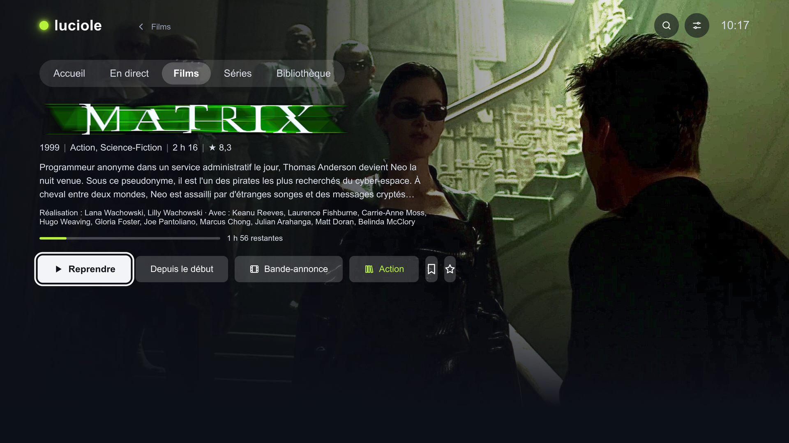

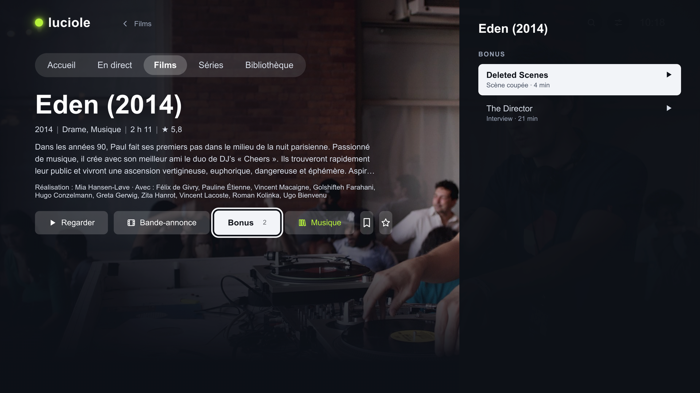

## La Bibliothèque

La Bibliothèque est **votre sélection** : les films et séries que vous voulez garder sous la main,
rangés dans vos catégories (action, science-fiction, comédie…). Le catalogue complet des fournisseurs,
lui, reste dans Films et Séries.

**Ajouter** : sur la fiche d'un film ou d'une série, bouton **Bibliothèque**. Luciole cherche le genre
du titre (sur TMDB si une clé est configurée, sinon d'après le fournisseur) et le range dans la catégorie
correspondante. La catégorie est créée au besoin, sous le nom du genre. Le bouton affiche ensuite la catégorie choisie.

**Changer de catégorie** : appuyez de nouveau sur ce bouton. La liste des catégories s'ouvre,
avec **Nouvelle catégorie…** et **Retirer de la Bibliothèque**.

Dans la rubrique Bibliothèque, en haut : **Films** ou **Séries**, puis la puce du **tri** (OK pour passer de
l'un à l'autre : ajout récent, date de sortie, de A à Z ; le choix est retenu), puis les catégories.

| Touche | Sur une affiche | Sur une catégorie |
|---|---|---|
| OK | ouvrir la fiche | afficher cette catégorie |
| Jaune | changer de catégorie | |
| Bleu | | renommer la catégorie |
| Rouge | retirer de la Bibliothèque | |

Pour ranger les catégories dans un autre ordre, en supprimer, ou reprendre plusieurs titres d'un coup :
page web, section Bibliothèque.

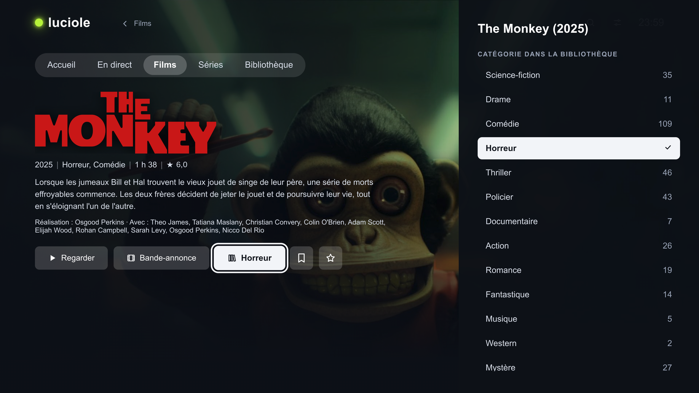

## La fiche d'une série

Le bouton principal reprend là où vous en étiez, ou passe à l'épisode suivant.
Les saisons sont en dessous, puis les épisodes, avec leur progression.
À la fin d'un épisode, le suivant démarre après dix secondes.

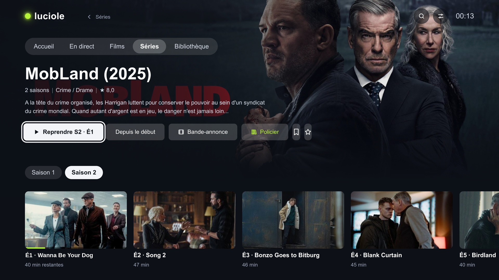

## Pendant un film ou un épisode

| Touche | Effet |
|---|---|
| OK | pause, lecture |
| Gauche, Droite sur la barre de temps | reculer de 10 s, avancer de 30 s |
| ◀◀, ▶▶ | idem, sans passer par la barre |
| **Bas** | ouvrir le volet du **résumé** : année, genre, durée, réalisation, histoire, acteurs |
| Haut ou Retour | refermer le résumé |
| P− | épisode suivant |

Le volet reste ouvert tant que vous ne le refermez pas ; le film continue derrière.

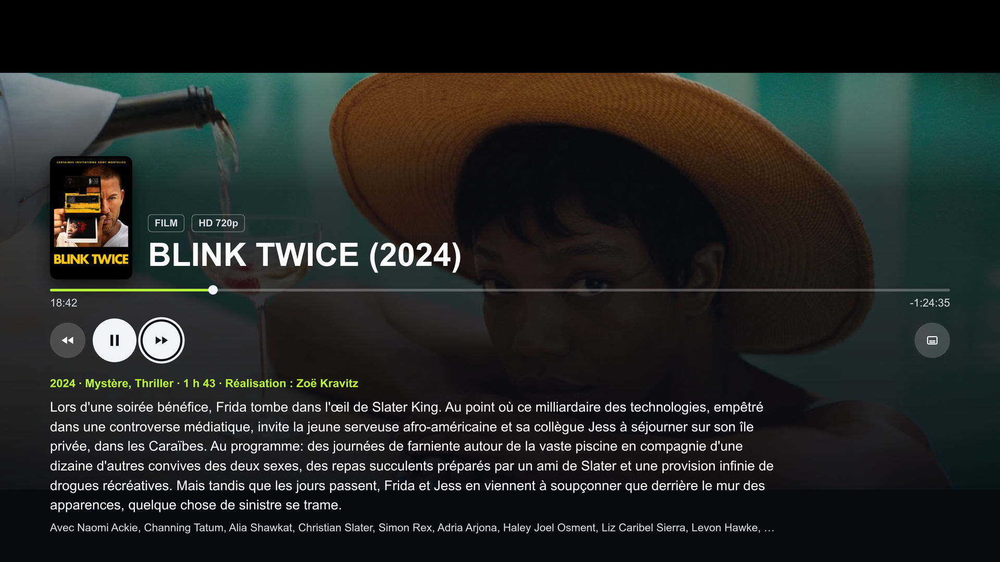

## La recherche

Chaînes, films et séries d'un coup, dès deux lettres. Les accents ne comptent pas.

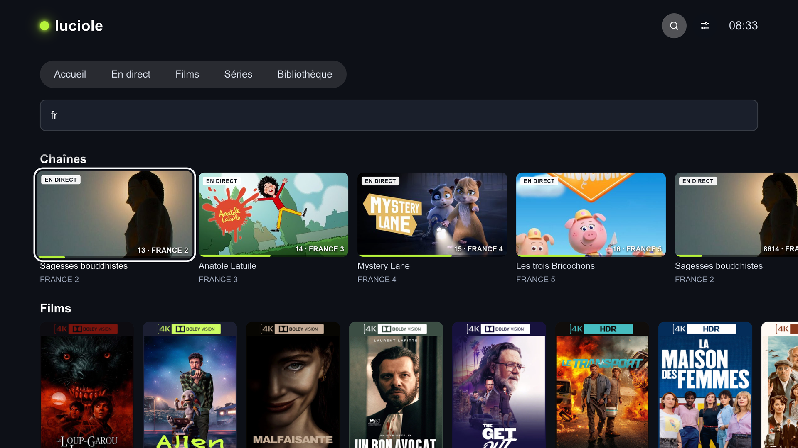

## Les réglages

- **Serveur Luciole** : l'adresse du serveur.
- **Une ligne par abonnement** : état, date d'expiration, connexions utilisées sur le nombre permis.
  Les jours restants passent à l'orange à un mois de l'échéance, au rouge à une semaine.
- **Démarrage automatique** : voir plus bas.
- **Langue** : français ou anglais. Les titres des programmes, films et séries restent dans la langue du fournisseur.
- **Thème** : Luciole (vert) ou Ambre.
- **Qualité des films de la médiathèque** : la meilleure lisible (par défaut), 1080p au plus, ou 720p au plus.
  Pour un film en plusieurs versions ; utile si le réseau peine avec le 4K.
- **Aperçu vidéo dans le guide** : la chaîne se lance en petit quand on s'arrête dessus.
- **Mettre à jour le catalogue maintenant**.

Langue et thème du téléviseur sont indépendants de ceux de la page web.

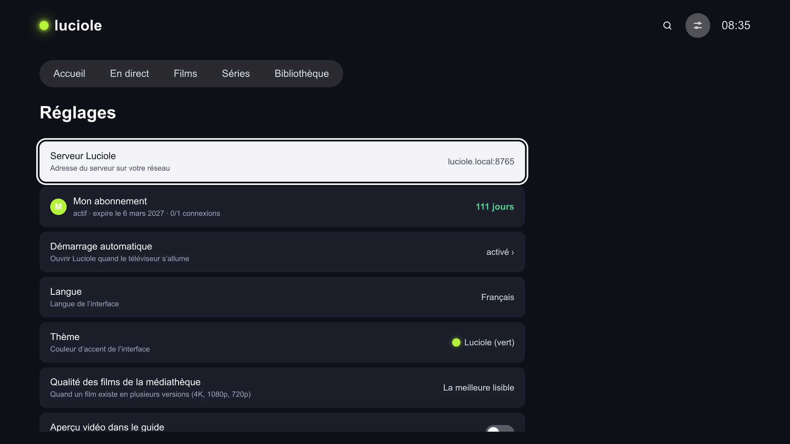

## Démarrage automatique

Tizen ne laisse pas une appli installée en mode développeur s'ouvrir toute seule à l'allumage :
c'est Samsung TV Plus qui démarre. Le serveur contourne cela : il surveille le téléviseur et,
dès qu'il s'allume, lui demande d'ouvrir Luciole.

Dans **Réglages › Démarrage automatique** :

1. **Adresse du téléviseur** : OK reprend l'adresse de ce téléviseur, vue par le serveur.
   Donnez-lui une adresse fixe dans votre modem, sinon elle changera un jour.
2. **Autoriser le serveur** : une fenêtre Samsung s'ouvre, acceptez-la avec la télécommande. Une seule fois.
3. **Ouvrir Luciole quand le téléviseur s'allume** : OK pour activer.

**Attente après l'allumage** et **Essais** se changent par OK. Si Samsung TV Plus reste à l'écran au réveil,
augmentez les essais. Si l'appel arrive trop tôt, augmentez l'attente.

Ces réglages sont aussi sur la page web, section Téléviseur.

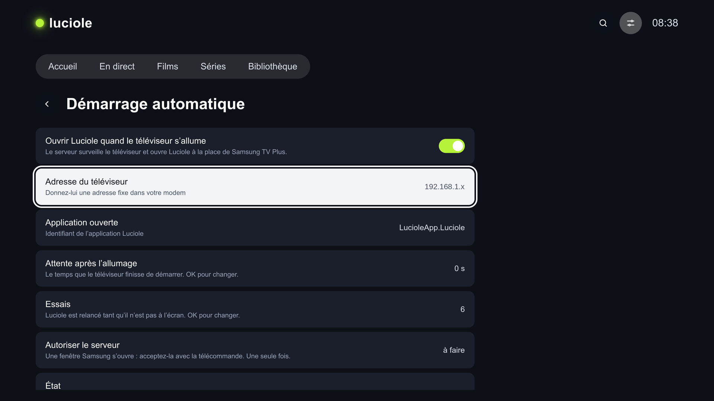

## Thème Ambre

Le second thème reprend l'accent ambre des premières versions. Même interface, autre lumière.

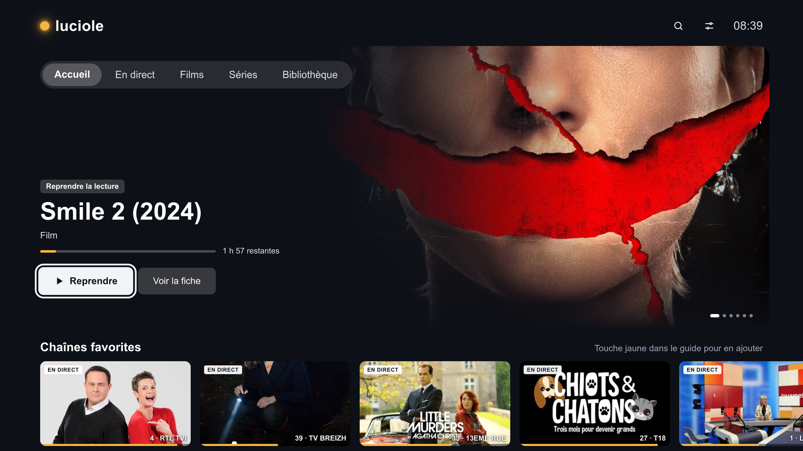

## En anglais

Toute l'interface existe en anglais : rubriques, boutons, messages et aides.

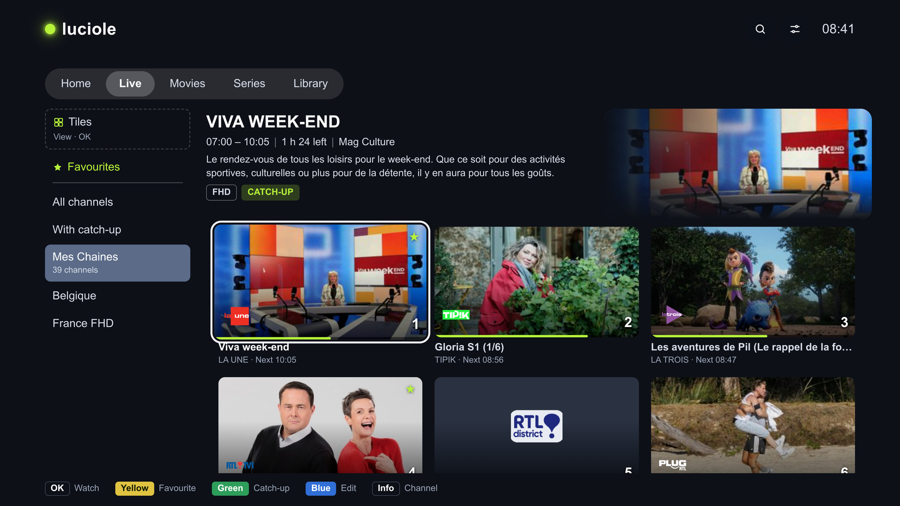
