# Luciole – le serveur

Le serveur fait tout le travail lourd à la place du téléviseur :

- toutes les 6 heures, il récupère le catalogue de chaque abonnement Xtream (direct, films, séries) et le guide des programmes ;
- il redimensionne affiches et logos à la taille de l'écran, retire le fond noir des logos et garde tout en cache ;
- il retient l'historique, la progression de lecture, la Bibliothèque, les listes et les favoris ;
- il peut ouvrir Luciole quand le téléviseur s'allume ;
- il sert la page web (`http://luciole.local:8765`) et répond à l'appli TV.

Il n'utilise que Python 3.11 ou plus et Pillow, qui sont dans les paquets Debian. Rien à installer avec pip.

## Où l'installer

N'importe quelle machine allumée en permanence sur le réseau de la maison, sous **Debian 12 ou 13** :

| Machine | Remarques |
|---|---|
| **Conteneur LXC sur Proxmox** | la solution la plus confortable : sauvegardes, redémarrage automatique, aucune machine en plus |
| **Raspberry Pi 4 ou 5** (Raspberry Pi OS 64 bits) | convient bien. La **première synchronisation est lente** (plusieurs minutes) : chaque image du catalogue est redimensionnée une fois. Ensuite tout est en cache. Préférez une carte SD rapide ou mieux, un SSD en USB |
| **Un PC ou un mini-PC** sous Debian | comme le conteneur, sans Proxmox |

Comptez 1 Go de mémoire, 2 Go si vous ajoutez de gros guides externes, et quelques Go de disque pour le cache des images.

La machine a besoin d'une **adresse fixe** : réservez-la dans votre modem (rubrique DHCP, souvent « adresse IP fixe »
ou « bail permanent »). Le téléviseur doit toujours la retrouver au même endroit.

## Exemple 1 : un conteneur Proxmox

Dans le shell de l'hôte Proxmox (adaptez le numéro 105 et le stockage `local-lvm`) :

```sh
pveam update
pveam available --section system | grep debian-13
pveam download local debian-13-standard_XXX_amd64.tar.zst      # le nom exact affiché juste avant

pct create 105 local:vztmpl/debian-13-standard_XXX_amd64.tar.zst \
  --hostname luciole --cores 2 --memory 1024 --swap 512 \
  --rootfs local-lvm:8 --net0 name=eth0,bridge=vmbr0,ip=dhcp \
  --unprivileged 1 --features nesting=1 --onboot 1
pct start 105
```

Le nom `luciole` donne directement l'adresse `luciole.local`. Un conteneur existant peut être renommé :
`pct set 105 --hostname luciole`, puis `pct reboot 105`.

Envoyez l'archive sur l'hôte Proxmox, puis poussez-la dans le conteneur (depuis votre ordinateur) :

```sh
scp luciole-server-1.0.1.tar.gz root@192.168.1.10:/root/
ssh root@192.168.1.10 "pct push 105 /root/luciole-server-1.0.1.tar.gz /root/luciole-server-1.0.1.tar.gz"
```

Puis, dans la console du conteneur (`pct enter 105`) :

```sh
cd /root && tar xzf luciole-server-1.0.1.tar.gz && cd luciole-server
sh install.sh
nano /etc/luciole/config.toml        # vos abonnements, voir plus bas
systemctl start luciole luciole-sync.timer
```

## Exemple 2 : un Raspberry Pi ou un PC

Sur un Raspberry Pi OS 64 bits ou une Debian fraîchement installée, en root :

```sh
cd /root && tar xzf luciole-server-1.0.1.tar.gz && cd luciole-server
sh install.sh
nano /etc/luciole/config.toml
systemctl start luciole luciole-sync.timer
```

C'est tout : le script installe les paquets, crée l'utilisateur `luciole`, les services et l'adresse `luciole.local`.
Le Raspberry Pi garde son propre nom ; `luciole.local` pointe vers lui en plus.

## Ce que fait le script d'installation

- installe `python3`, `python3-pil`, et `avahi-daemon` pour l'adresse `luciole.local` ;
- règle le fuseau horaire s'il est encore en UTC (sinon les heures du guide seraient décalées).
  `Europe/Brussels` par défaut, à changer ainsi : `LUCIOLE_TZ=Europe/Paris sh install.sh` ;
- copie Luciole dans `/opt/luciole`, la configuration dans `/etc/luciole`, les données dans `/var/lib/luciole` ;
- demande, à la première installation, si la médiathèque reste **en lecture seule** (par défaut) ou si Luciole
  peut **écrire** dans vos dossiers pour convertir le son (voir « Conversion du son ») ; dans ce cas il installe `ffmpeg`.
  Sans question : `LUCIOLE_ECRITURE=oui sh install.sh` ou `=non` ;
- installe les services `luciole`, `luciole-sync` (toutes les 6 heures) et, si besoin, `luciole-mdns`.

Pour ne pas publier `luciole.local` : `LUCIOLE_MDNS=non sh install.sh`.

**Mettre à jour** : décompresser la nouvelle archive et relancer `sh install.sh`. Configuration, données
et réglages sont conservés ; la base se met à niveau toute seule.

## Configurer vos abonnements

Tout est dans `/etc/luciole/config.toml`, un bloc `[[xtream]]` par abonnement :

```toml
[[xtream]]
nom = "Maison"
id = "maison"
server = "http://adresse-du-fournisseur:8080"
username = "votre_identifiant"
password = "votre_mot_de_passe"

[[xtream]]
nom = "Sport"
id = "sport"
server = "http://autre-fournisseur:80"
username = "..."
password = "..."
decalage = 1000
```

- **`id`** relie vos favoris, votre historique, vos bouquets et votre Bibliothèque à cet abonnement.
  Choisissez-le une fois, en minuscules, et n'y touchez plus. Sans `id`, l'adresse du fournisseur sert d'identifiant.
- **`decalage`** s'ajoute à tous les numéros de chaînes de l'abonnement. Deux fournisseurs ont souvent
  chacun leur chaîne 1 : avec `decalage = 1000`, celle du second devient la 1001.
- **`lettre`** et **`couleur`** choisissent la pastille de l'abonnement (sinon automatique, et réglable sur la page web).
- `live_format`, `epg_url`, `replay_format`, `replay_timezone` : voir les commentaires du fichier.

Après une modification : `systemctl restart luciole`, puis une synchronisation (`systemctl start luciole-sync`
ou le bouton de la page web).

**Retirer un abonnement** : supprimez son bloc. À la synchronisation suivante, ses chaînes, films et séries
disparaissent. Remis plus tard avec le même `id`, il retrouve ses favoris et sa place dans les bouquets.

## Vérifier

Ouvrez **`http://luciole.local:8765`** dans un navigateur (ou `http://ADRESSE:8765`).
La page d'accueil montre vos abonnements, le catalogue, le téléviseur et la Bibliothèque.

Si `luciole.local` ne répond pas :

- **Windows 10 et 11, macOS, iPhone, Android récent** : ça marche directement.
- **Linux** : il faut `nss-mdns`. Sur Arch : `pacman -S nss-mdns`, puis dans `/etc/nsswitch.conf`,
  sur la ligne `hosts:`, ajoutez `mdns_minimal [NOTFOUND=return]` avant `resolve`. Sur Debian/Ubuntu : `apt install libnss-mdns`.
- **Le téléviseur** ne connaît pas les adresses `.local` : dans l'appli, tapez l'adresse IP du serveur.

Si un compteur reste à 0, consultez le journal :

```sh
journalctl -u luciole -u luciole-sync -n 50
```

| Action | Commande |
|---|---|
| Relancer une synchronisation tout de suite | `systemctl start luciole-sync` |
| Prochaine synchronisation prévue | `systemctl list-timers luciole-sync.timer` |
| Redémarrer le serveur | `systemctl restart luciole` |
| Mettre à jour Luciole | décompresser la nouvelle archive puis `sh install.sh` |

## La page web

**`http://luciole.local:8765`** ouvre l'accueil : l'état de chaque abonnement, le catalogue avec un bouton de
synchronisation, le téléviseur, la Bibliothèque, ce qui passe en ce moment sur vos chaînes favorites,
et un raccourci vers chaque réglage.

Les **réglages** sont à `http://luciole.local:8765/reglages`. Tout s'enregistre tout de suite.
En haut à droite : le thème (Luciole ou Ambre) et la langue (français ou anglais) de la page,
indépendants de ceux du téléviseur.

### Abonnements

Une fiche par abonnement : état, date d'expiration, jours restants, connexions utilisées sur le nombre permis,
taille du catalogue, dernière synchronisation et dernière erreur. La jauge se vide sur le dernier mois
et passe à l'orange puis au rouge.

En bas de chaque fiche, la **pastille** : sa lettre et sa couleur, celles qu'on voit sur le téléviseur.
« Automatique » revient au choix de Luciole. **Synchroniser** ne met à jour que cet abonnement.

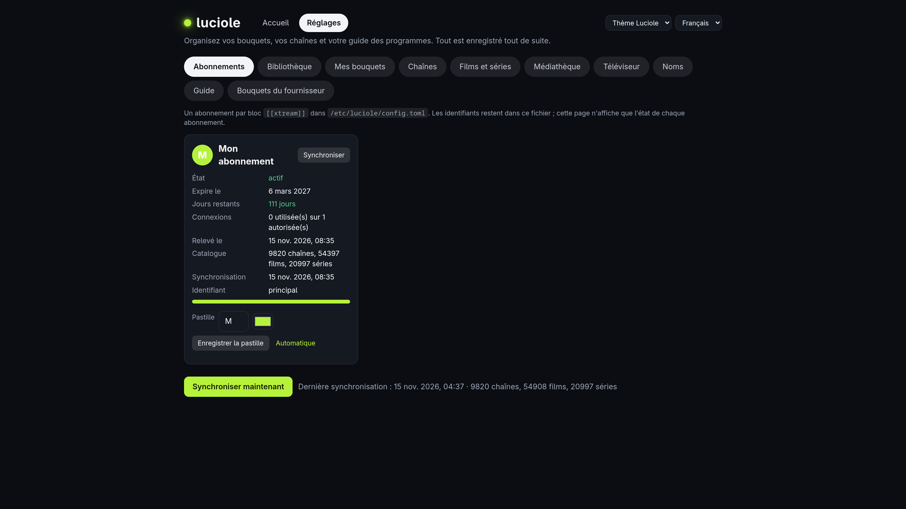

### Bibliothèque

À gauche, les catégories : renommer, monter, descendre, supprimer, en créer une nouvelle.
En supprimant une catégorie, vous choisissez ce que deviennent ses titres : quitter la Bibliothèque
ou rejoindre une autre catégorie. À droite, les titres : changer leur catégorie, les retirer.
Pour ajouter d'un coup les films et les séries de vos dossiers, voir la section Médiathèque plus bas.

Un titre que le fournisseur retire de son catalogue disparaît de la Bibliothèque, et revient s'il le remet.

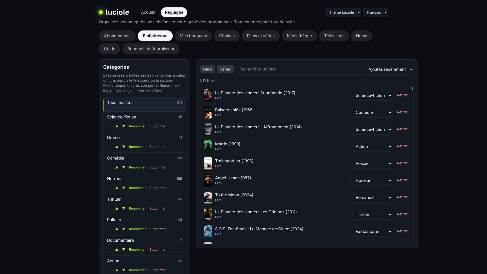

### Mes bouquets

Vos propres listes, pour le **direct**, les **films** et les **séries** (trois boutons en haut).
Sur le téléviseur, elles passent avant celles des fournisseurs. Un bouquet peut mélanger des chaînes de plusieurs abonnements.

- **Nouveau bouquet** puis **Ajouter des chaînes** : recherche, filtre par catégorie, cases à cocher.
- **Depuis une catégorie** reprend d'un coup toute une catégorie d'un fournisseur.
- Les lignes se rangent au glisser-déposer. Pour le direct, **Renuméroter** attribue les numéros dans cet ordre.
- **Chaque bouquet a sa propre numérotation** : la même chaîne peut être la 2 dans « Mes chaînes » et la 105
  dans « Belgique ». Sur la TV, le numéro affiché et les touches 0–9 suivent le bouquet ouvert.
  Un clic sur le numéro d'une ligne le change pour ce bouquet seulement (vide : son numéro habituel).
  Dans **Renuméroter**, la case « Utiliser aussi ces numéros dans Toutes les chaînes » les applique partout.
- Supprimer un bouquet n'efface ni les chaînes, ni les films, ni les séries.

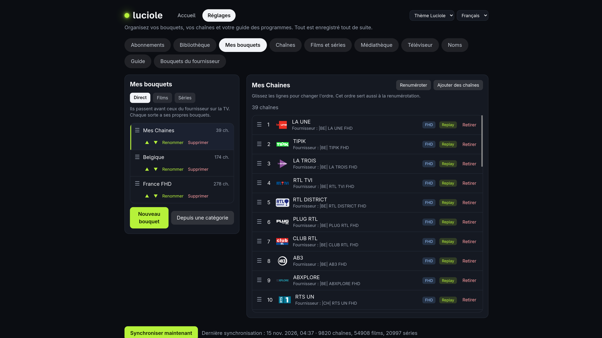

### Chaînes

Changez le numéro ou le nom d'une chaîne, puis Entrée. Un champ vide revient à la valeur du fournisseur.
Un numéro en orange est utilisé par plusieurs chaînes. **Numéros d'origine** oublie tous les numéros choisis.

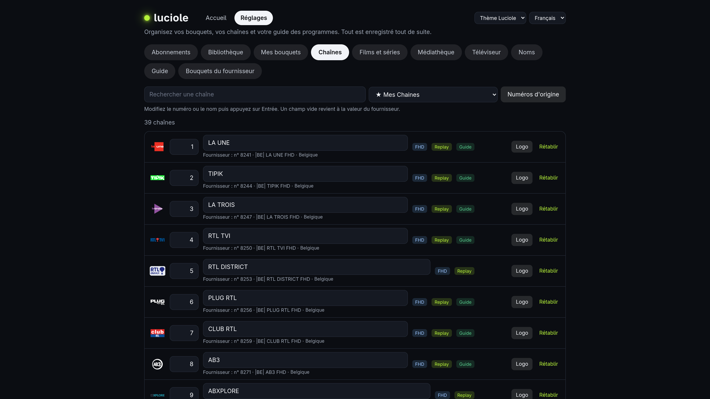

**Ajouter une chaîne** ajoute un flux qui ne vient pas d'un abonnement : soit **un lien** (nom, adresse
du flux `http(s)://…`, logo et numéro facultatifs), soit **une liste M3U** (son adresse, ou son contenu collé ;
chaque entrée `#EXTINF` devient une chaîne avec son nom et son logo, les liens déjà présents sont ignorés).
Ces chaînes vont dans le bouquet **Mes liens**, et aussi, si vous le choisissez, dans un de vos bouquets.
Ensuite elles se gèrent comme les autres : nom, numéro, logo, guide, favoris, bouquets.
Sur leur ligne, **Lien** change l'adresse du flux et **Supprimer** les retire.
Le téléviseur lit le flux tel quel : il doit être en clair (pas de DRM) et dans un format que la TV sait lire (HLS, MPEG-TS…).

### Logos

Bouton **Logo** sur une chaîne : une adresse web ou un fichier du PC. **Rétablir** revient au logo du fournisseur,
ou à défaut à celui du guide externe.

Tous les logos passent par la même préparation : le fond noir uni est retiré, le logo est rogné,
puis posé au centre d'un carré transparent, à une taille comparable d'un logo à l'autre.
Cela marche pour la grande majorité. Un logo qui contient lui-même du noir peut garder un morceau de fond :
c'est le cas où l'on remplace le logo à la main, de préférence par un PNG transparent.

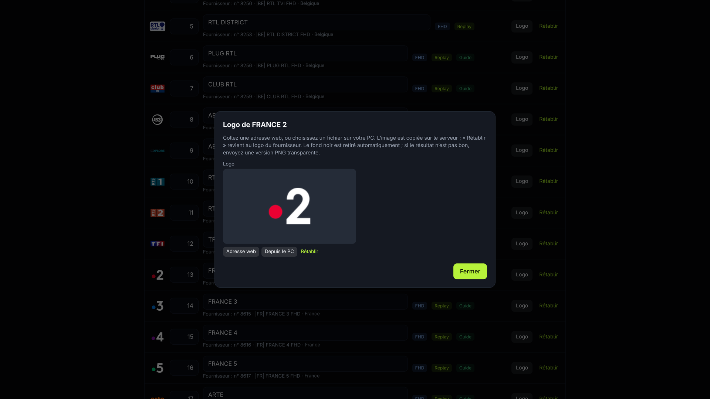

### Films et séries

Tout le catalogue, avec un sélecteur Films / Séries, une recherche et un filtre par catégorie.
Tapez un titre puis Entrée pour le fixer ; videz le champ ou **Rétablir** pour revenir aux règles de nettoyage.

**Modifier** ouvre la fiche : titre, résumé, jaquette, fond, logo du titre, bande-annonce. Pour une image, trois provenances :
une **adresse web**, **TMDB** (avec une clé), ou un fichier **depuis le PC**. L'image est copiée sur le serveur.
Avec TMDB, choisissez le titre : toutes ses jaquettes ou tous ses fonds s'affichent, les fonds sans texte en premier.
**Rétablir** revient au fournisseur.

La fiche a aussi un **logo du titre** (l'image transparente qui remplace le titre écrit sur la TV) et une
**bande-annonce** (lien YouTube). Sans choix à la main, Luciole prend le `clearlogo.png` posé à côté du fichier,
sinon le logo TMDB dans votre langue, puis en anglais (avec une clé TMDB) ; et la bande-annonce du fournisseur ou de TMDB.

Les corrections sont rangées à part du catalogue : une synchronisation ne les écrase pas.
Une image remplacée s'affiche tout de suite, y compris sur le téléviseur.

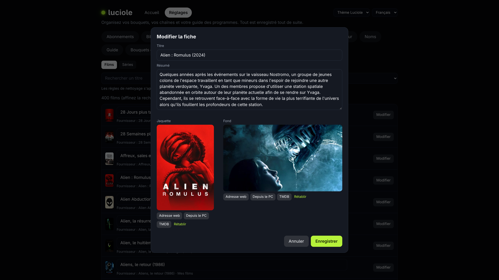

### Noms

Les fournisseurs préfixent souvent leurs titres (« FR », « BE » entre barres verticales) et ajoutent « HD » à la fin.
Des règles enlèvent tout ça : trois actives au départ, trois prêtes mais désactivées. Elles s'appliquent aux chaînes,
films, séries et noms de bouquets, avec un aperçu avant / après. Un nom tapé à la main n'est jamais touché.

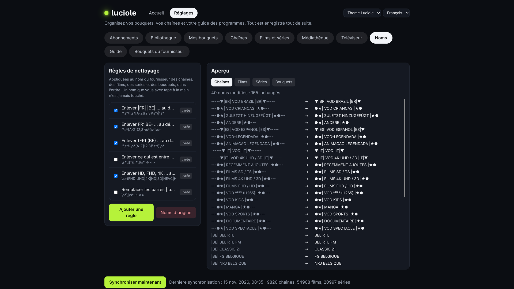

### Guide

Le guide des fournisseurs est souvent pauvre. Ajoutez des **sources XMLTV publiques** (`.xml` ou `.xml.gz`) :
elles donnent souvent un résumé et une vignette par programme. Pour les chaînes françaises et belges,
le projet **xmltvfr.fr** convient bien.

Luciole associe chaque chaîne par son nom ; **Associer** corrige à la main celles qu'il n'a pas reconnues.
Une chaîne sans guide externe garde celui de son fournisseur. Les sources sont retéléchargées à chaque synchronisation.

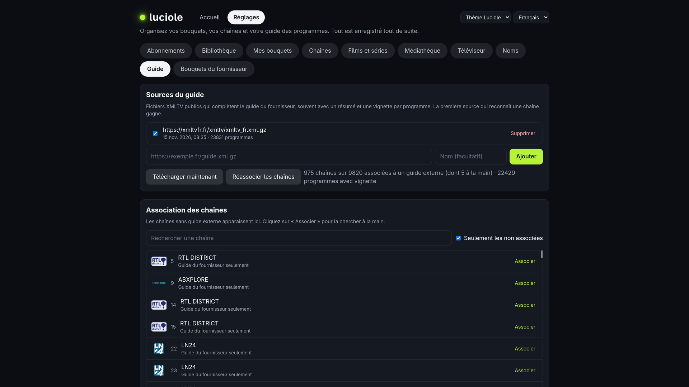

### Bouquets du fournisseur

Les fournisseurs proposent souvent des centaines de catégories. Cochez celles à garder, décochez le reste.
Cliquez sur un nom pour le renommer. Avec plusieurs abonnements, chaque catégorie porte la pastille du sien.

Pour trier en masse, des règles dans `/etc/luciole/config.toml`, section `[filtres]` :

```toml
[filtres]
direct_garder  = ["BE *", "FR *"]          # seulement les catégories qui commencent par BE ou FR
direct_masquer = ["*adult*", "*24/7*"]
films_masquer  = ["AR *", "TR *"]
```

`*` remplace n'importe quel texte ; majuscules et accents ne comptent pas. Les règles valent pour tous les abonnements
et pour les catégories à venir. Un choix fait à la main passe avant ; « Règle auto » l'annule.

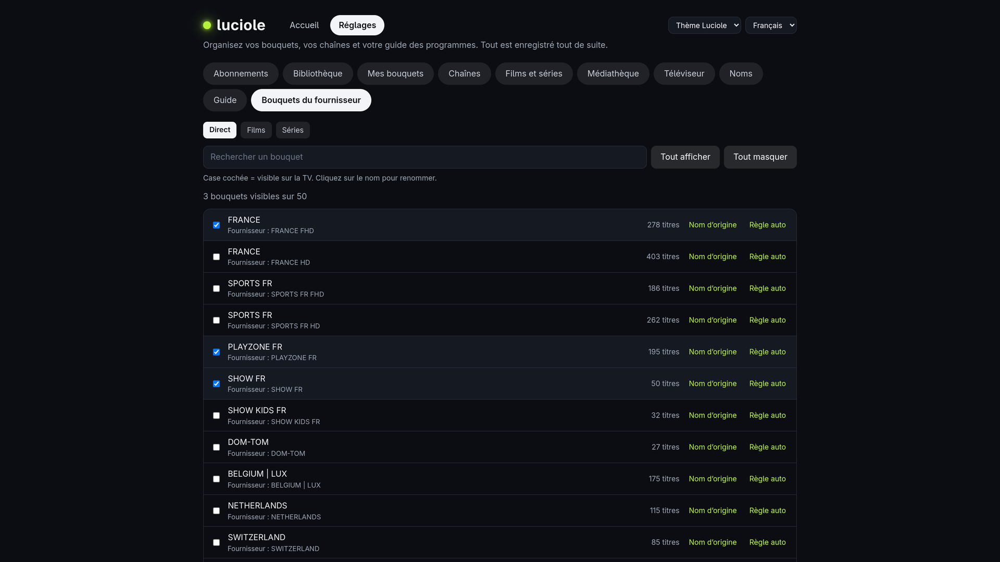

### Téléviseur

Le démarrage automatique, comme sur le téléviseur (Réglages › Démarrage automatique), avec en plus
**Lancer maintenant** pour essayer, et la liste des applications installées sur le téléviseur.

1. Donnez au téléviseur une **adresse fixe** dans votre modem.
2. Allumez-le, saisissez son adresse, cliquez sur **Demander l'autorisation** et acceptez la fenêtre sur l'écran.
3. Vérifiez que l'application est `LucioleApp.Luciole` (bouton **Choisir** dans la liste).
4. **Lancer maintenant** : Luciole doit s'ouvrir sur le téléviseur.
5. Cochez **Ouvrir Luciole quand le téléviseur s'allume**.

Le serveur interroge le téléviseur toutes les 3 secondes quand il est éteint, toutes les 15 quand il est allumé.
À l'allumage, il attend le **délai**, demande l'ouverture de Luciole, vérifie quatre secondes plus tard qu'il est bien à l'écran,
et recommence jusqu'au nombre d'**essais**. L'autorisation est gardée dans `/var/lib/luciole/tv-token.json`.

| Ce que dit la page | Ce qu'il faut faire |
| --- | --- |
| « Téléviseur : injoignable » alors qu'il est allumé | l'adresse est fausse, ou le téléviseur n'est pas sur le même réseau |
| « pas encore autorisé » | **Demander l'autorisation** et accepter la fenêtre sur l'écran |
| « Luciole n'est pas à l'écran » après le lancement | augmentez les **essais**, et le **délai** si le téléviseur est lent |
| rien au réveil, mais « Lancer maintenant » fonctionne | le téléviseur se coupe du réseau en veille : augmentez le délai |

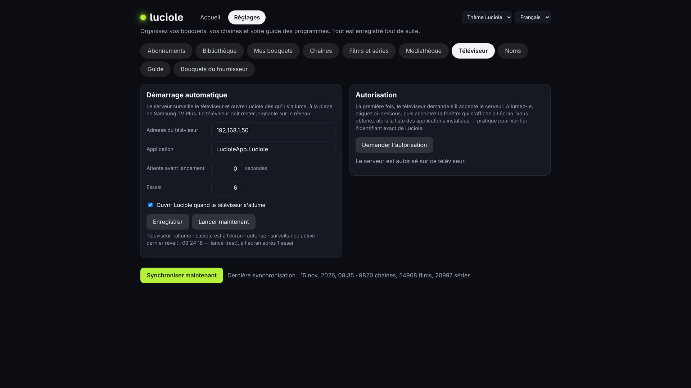

### Médiathèque

Vos films et séries posés sur un NAS apparaissent à côté du catalogue, dans **Mes films** et **Mes séries**.
Le serveur lit les dossiers, reconnaît les titres, va chercher fiche et jaquette, puis envoie le fichier au téléviseur.

**Monter le partage.** Sur Proxmox, le conteneur non privilégié ne monte pas lui-même un partage réseau :
on le monte sur l'hôte, puis on le passe au conteneur. **Sur l'hôte Proxmox** :

```bash
apt install -y cifs-utils
mkdir -p /mnt/medias
printf 'username=VOTRE_UTILISATEUR\npassword=VOTRE_MOT_DE_PASSE\n' > /root/.smb-nas
chmod 600 /root/.smb-nas
echo '//192.168.1.40/mon-partage /mnt/medias cifs credentials=/root/.smb-nas,ro,uid=100000,gid=100000,iocharset=utf8,vers=3.0,_netdev,nofail 0 0' >> /etc/fstab
mount -a
pct set 105 -mp0 /mnt/medias,mp=/mnt/medias,ro=1
pct reboot 105
```

Sur un Raspberry Pi ou un PC, la même ligne `/etc/fstab` suffit, avec `uid=` et `gid=` de l'utilisateur `luciole`
(`id luciole`), et sans l'étape `pct`.

**Déclarer les dossiers** dans la section Médiathèque, un par type (`/mnt/medias/Films` en « Films »,
`/mnt/medias/Séries` en « Séries »), puis **Analyser**.

**La clé TMDB, si besoin.** Une médiathèque déjà rangée par tinyMediaManager, Jellyfin ou Kodi n'a besoin de rien :
Luciole lit l'identifiant `{tmdb-170}` dans le nom du dossier (ou `{tmdbid-170}`, `[tmdbid-170]`, `{id - 170}`), les `.nfo` et les images déjà présentes.
Une clé TMDB (gratuite, sur themoviedb.org, *Paramètres > API*, clé **v3**) sert aux fichiers non balisés,
aux jaquettes de l'éditeur, et à deviner la catégorie de la Bibliothèque :

```toml
[medias]
tmdb_key = "votre_cle"
```

**Nommer ses fichiers.** Ce qui marche bien :

```
Films/Dune (2021)/Dune (2021).mkv
Films/Le.Grand.Bain.2018.FRENCH.1080p.mkv
Séries/Le Bureau des légendes (2015)/Saison 1/Le.Bureau.des.legendes.S01E01.mkv
Séries/Baraki/Baraki.1x01.mkv
Films/28 Jours plus tard (2002) {tmdb-170}/28 Jours plus tard (2002) {tmdb-170}.mkv
```

**Plusieurs versions d'un film.** Un film en 4K, 1080p et 720p n'a qu'une fiche. Les fichiers sont regroupés
par identifiant TMDB (`{tmdb-…}` ou trouvé par le serveur), ou par même titre et même année dans le même dossier,
à la manière de Jellyfin : `Dune (2021).mkv`, `Dune (2021) - 4K.mkv`, `Dune (2021) - Director's Cut.mkv`.
Le téléviseur démarre la meilleure version qu'il sait lire (dans la limite choisie dans ses réglages) ;
la fiche permet d'en choisir une autre. Dans la liste **Films** de la section Médiathèque, chaque version l'indique,
avec **Démarrer celle-ci** pour la fixer. Deux fichiers regroupés à tort se séparent avec **Corriger la fiche**.

Chaque version porte sa définition, son codec, sa durée et le nom de son **édition**, lu dans le nom du fichier :
`{edition-The Remus Cut}` (Plex, Jellyfin), `Film (2024) - Director's Cut`, ou ce qui est entre parenthèses ou crochets
quand ce n'est ni l'année ni une mention technique : `Alien - Romulus (The Remus Cut) (2024).mkv`,
`Matrix [Version 35 MM] (1999).mkv`. Si le nom ne convient pas, **Nommer la version** le remplace.

**Bonus, bandes-annonces, images.** L'arborescence de Kodi, Plex et Jellyfin est comprise :

```
Films/Drive (2011) {tmdb-64690}/
    Drive (2011) {tmdb-64690}.mkv
    Drive (2011) {tmdb-64690}.nfo
    Drive (2011) {tmdb-64690}-poster.jpg        affiche
    Drive (2011) {tmdb-64690}-fanart.jpg        fond
    Drive (2011) {tmdb-64690}-clearlogo.png     logo du titre sur la fiche
    Drive (2011) {tmdb-64690}-trailer.mp4       bande-annonce, lue à la place de YouTube
    Deleted Scenes/…  Interviews/…  Featurettes/…  Behind The Scenes/…  Extras/…  Trailers/…
```

Les bonus (sous-dossiers ci-dessus, ou fichiers terminés par `-trailer`, `-featurette`, `-interview`, `-deleted`,
`-behindthescenes`, `-scene`, `-short`, `-sample`, `-extra`…) ne deviennent jamais des films : ils sont rattachés
au film ou à la série du dossier, derrière un bouton **Bonus** de la fiche. Un dossier de bonus n'est reconnu
qu'à l'intérieur du dossier d'un film ou d'une série : un dossier `Shorts` à la racine des Films reste un dossier de films.

**Ce que le téléviseur sait lire.** Rien n'est transcodé : MKV ou MP4 en H.264, H.265, MPEG-2, MPEG-4, VP9 ou AV1,
son AAC, AC3, EAC3, MP3, Opus ou FLAC. Le DTS ne passe pas. Avec `ffmpeg` installé sur le serveur
(`apt install ffmpeg`), l'analyse marque « illisible » les fichiers qui poseront problème, dans la vue **À vérifier**.

**Conversion du son.** Le son DTS ou Dolby TrueHD ne passe pas sur le téléviseur. Si vous l'y autorisez,
Luciole le convertit en **AC3** (5.1 au plus, 640 kb/s), que le téléviseur lit et transmet à la barre de son.
L'image, les sous-titres, les chapitres et les autres pistes son sont recopiés tels quels : c'est rapide
(quelques minutes par film, surtout le temps de relire et réécrire le fichier) et sans perte d'image.
**La vidéo n'est jamais réencodée par Luciole** : un fichier dont l'image ne passe pas se convertit en dehors,
avec HandBrake par exemple.

Par défaut, Luciole ne fait que **lire** vos dossiers. Pour autoriser l'écriture :

1. Le script d'installation pose la question à la première installation. Pour changer d'avis ensuite :
   `LUCIOLE_ECRITURE=oui sh install.sh` (ou `non`). Il installe aussi `ffmpeg`.
   On peut aussi écrire `ecriture = true` dans la section `[medias]` de `/etc/luciole/config.toml`,
   installer `ffmpeg` et redémarrer Luciole.
2. Le partage doit être monté **en écriture pour l'utilisateur `luciole`**. Sur Proxmox, cherchez son numéro
   dans le conteneur (`pct exec 105 -- id -u luciole`, par exemple `999`), ajoutez 100000 (`100999`),
   et sur l'hôte montez le partage avec ce numéro, sans `ro`, puis passez-le au conteneur sans `ro=1` :

   ```bash
   # dans /etc/fstab de l'hôte, à la place de la ligne en lecture seule
   //192.168.1.40/mon-partage /mnt/medias cifs credentials=/root/.smb-nas,uid=100999,gid=100999,file_mode=0664,dir_mode=0775,iocharset=utf8,vers=3.0,_netdev,nofail 0 0
   umount /mnt/medias && mount -a
   pct set 105 -mp0 /mnt/medias,mp=/mnt/medias
   pct reboot 105
   ```

   Le compte du NAS indiqué dans `/root/.smb-nas` doit lui aussi avoir le droit d'écrire sur le partage.

Ensuite, dans la section Médiathèque : un bouton **Convertir le son** sur chaque fichier concerné de la vue
**À vérifier**, et **Convertir le son de ce dossier** sous la liste des dossiers. Les fichiers passent l'un après
l'autre, l'avancement s'affiche, et la page peut être fermée. Chaque fichier converti est vérifié (même durée,
mêmes pistes, plus de son illisible) avant de remplacer l'original, sous le même nom : la fiche, la reprise
et la Bibliothèque ne bougent pas. L'original est **supprimé** ; cochez **Garder l'original** pour le ranger
plutôt dans le dossier caché `.luciole-originaux` du dossier, que vous viderez vous-même.
Un dossier marqué « lecture seule pour Luciole » n'est pas monté en écriture. Pour le vérifier, sur l'hôte :
`pct exec 105 -- su -s /bin/sh luciole -c 'touch /mnt/medias/.t && rm /mnt/medias/.t && echo OK'`.
Si c'est « OK » mais que la page dit encore « lecture seule », relancez `sh install.sh` : avec l'écriture
autorisée, il desserre aussi le verrou du service (`/etc/systemd/system/luciole.service.d/ecriture.conf`).

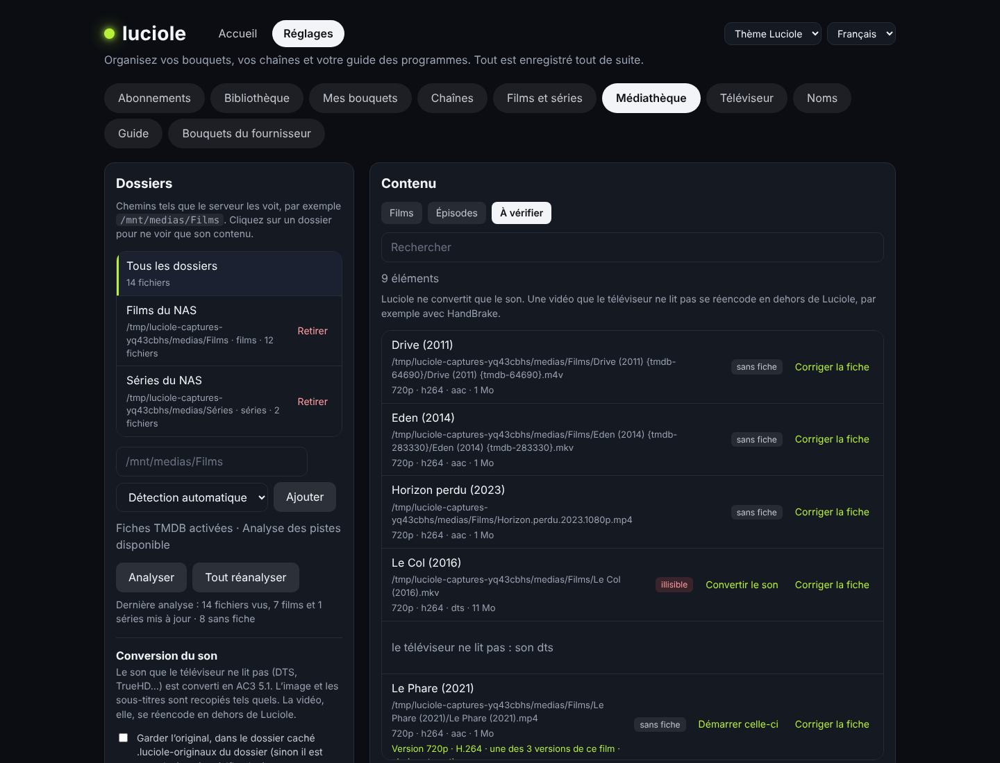

L'analyse est relancée à chaque synchronisation et ne relit que les fichiers nouveaux ou modifiés.
Si le NAS est éteint, Luciole le remarque et ne retire rien.

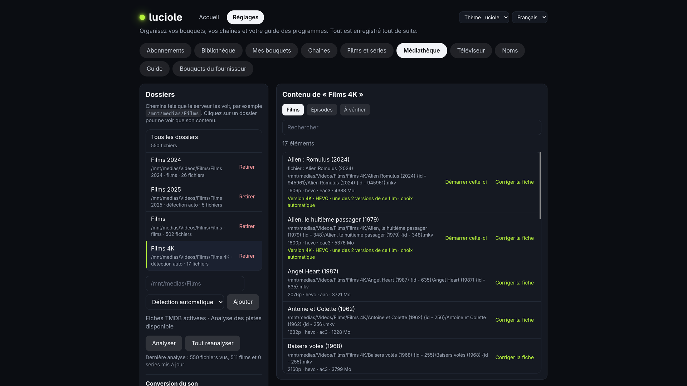

**Un dossier à la fois.** Cliquez sur un dossier de la liste : « Contenu » et « Choisir pour la Bibliothèque »
ne montrent plus que lui (recliquez, ou « Tous les dossiers », pour tout revoir). Un dossier de séries
passe directement sur les séries. Le choix est retenu d'une visite à l'autre.

**Choisir pour la Bibliothèque.** Sous les dossiers, tous les films ou toutes les séries trouvés, en affiches.
Filtrez par catégorie, ou sur « Pas encore dans la Bibliothèque », cochez
(Maj + clic pour plusieurs d'affilée, ou « Tout cocher »), puis choisissez où les ranger :

- **selon le genre** : chaque titre rejoint la catégorie de son genre, créée au besoin ;
- **dans une catégorie** existante ;
- **dans une nouvelle catégorie**, nommée sur le moment.

« Retirer » sort les titres cochés de la Bibliothèque ; les fichiers ne sont pas touchés.
Sur le téléviseur, rien ne change : le bouton « Bibliothèque » de chaque fiche reste là.

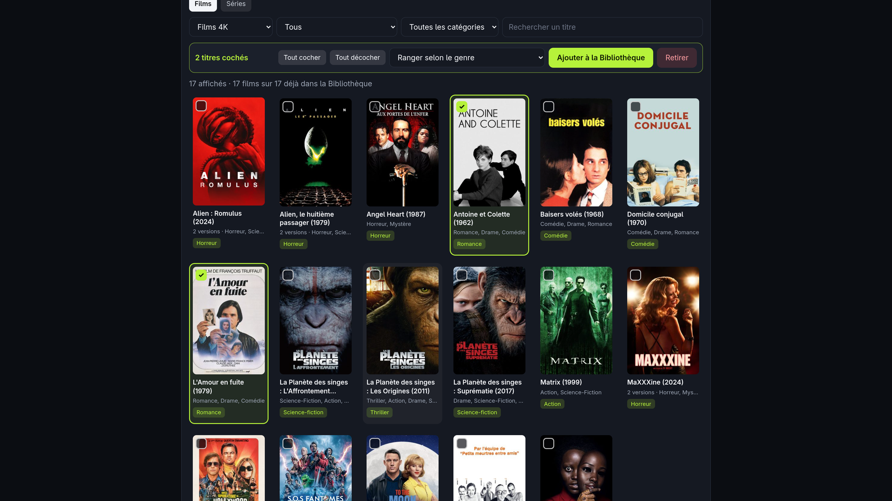

## Replay

Les chaînes dont le fournisseur garde les émissions passées sont marquées « Replay ». Si un replay ne démarre pas :

1. essayez `replay_format = "php"` dans le bloc de l'abonnement ;
2. si l'émission démarre avec une heure de décalage, réglez `replay_timezone` (par exemple `"Europe/Paris"` ou `"UTC"`).

Après chaque modification : `systemctl restart luciole`.

## Où sont les données

- `/etc/luciole/config.toml` : la configuration, avec les identifiants des abonnements ;
- `/var/lib/luciole/luciole.db` : catalogue, guide, historique, Bibliothèque, listes et réglages ;
- `/var/lib/luciole/img/` : le cache des images. Une image qui n'a pas servi depuis 30 jours y est effacée à la synchronisation ; le dossier peut aussi être supprimé, il se reconstruit ;
- `/var/lib/luciole/art/` : les jaquettes, fonds et logos que vous avez choisis. **Celui-là ne se reconstruit pas** ;
- vos fichiers vidéo ne sont jamais copiés ni modifiés : le serveur les lit sur place, en lecture seule.

Sur Proxmox, la sauvegarde du conteneur suffit. Ailleurs, sauvegardez `/etc/luciole` et `/var/lib/luciole`.

## Bon à savoir

- Si un abonnement ne répond pas, son ancien catalogue est conservé et les autres sont mis à jour normalement.
- Si certaines chaînes coupent, essayez `live_format = "m3u8"` dans le bloc de l'abonnement.
- Ne publiez pas le port 8765 sur Internet dans votre modem. Pour une protection en plus, mettez un mot de passe
  dans `token` (section `[server]`) : l'appli le demande au premier lancement, et la page web s'ouvre alors
  avec `?token=…` au bout de l'adresse.

## API

Pour l'appli TV, et pour qui voudrait s'en servir ailleurs. Tout est en JSON.

| Méthode | Adresse | Rôle |
|---|---|---|
| GET | `/api/status` | état, dernières synchronisations, compteurs, version, abonnements (nom, lettre, couleur) |
| POST | `/api/sync` | lance une synchronisation ; `{src}` pour un seul abonnement |
| GET | `/api/providers` | abonnements : état, expiration, connexions, pastille |
| POST | `/api/providers/set` | `{src, letter, color}` (vide = automatique) |
| GET | `/api/home` | accueil : reprendre, chaînes favorites, ajouts récents |
| GET | `/api/categories?kind=live\|vod\|series&all=1&src=` | catégories visibles (ou toutes), éventuellement d'un seul abonnement |
| GET | `/api/live?cat=all\|fav\|replay\|<id>&src=` | chaînes avec programme en cours et suivant |
| GET | `/api/guide?cat=&src=&start=&hours=&offset=&limit=` | grille du guide |
| GET | `/api/channel?id=` | page d'une chaîne |
| GET | `/api/epg?id=&hours=&back=` | guide d'une chaîne |
| GET | `/api/vod`, `/api/series` | films, séries (`cat`, `sort`, `offset`, `limit`) |
| GET | `/api/movie?id=`, `/api/series/detail?id=` | fiches, avec `library` |
| GET | `/api/search?q=` | recherche sans accents |
| GET | `/api/play?kind=live\|movie\|episode\|replay&id=` | adresse de lecture et position de reprise |
| POST | `/api/progress` | `{kind, id, position, duration, series_id}` |
| GET / DELETE | `/api/history` | historique |
| GET / POST / DELETE | `/api/watchlist` | à regarder plus tard |
| POST | `/api/favchannels` | `{id, on}` |
| GET | `/api/library?cat=&kind=&sort=` | Bibliothèque : catégories et titres |
| POST | `/api/library/add` | `{kind, id, lang}` : catégorie devinée d'après le genre ; `{cat}` pour la fixer |
| POST | `/api/library/move`, `/api/library/remove` | changer de catégorie, retirer |
| POST | `/api/movie/version` | `{id, file}` : la version qui démarre (`file = 0` : automatique) |
| POST | `/api/library/add_many`, `/api/library/remove_many` | `{kind, ids, cat}` : plusieurs titres d'un coup (20 par appel conseillé) |
| GET | `/api/medias/titles?kind=&root=&q=&state=` | films ou séries des dossiers, avec leur catégorie de Bibliothèque |
| GET / POST | `/api/medias/convert` | état de la file ; `{ids}` ou `{root}` : convertir le son (si `ecriture = true`) |
| POST | `/api/medias/convert/cancel`, `/forget`, `/keep` | arrêter, effacer la liste, `{keep}` garder les originaux |
| POST / DELETE | `/api/library/cats…` | créer, renommer, déplacer, supprimer une catégorie |
| GET / POST | `/api/tv`, `/api/tv/set`, `/api/tv/pair`, `/api/tv/test` | démarrage automatique |
| GET | `/img?u=&w=&m=logo` | image redimensionnée ; `m=logo` : logo préparé (fond retiré, carré transparent) |

Les identifiants des chaînes, films, séries et épisodes sont propres à Luciole :
`numéro de l'abonnement × 10 000 000 000 + identifiant du fournisseur`. Les catégories s'écrivent `abonnement:identifiant`.
